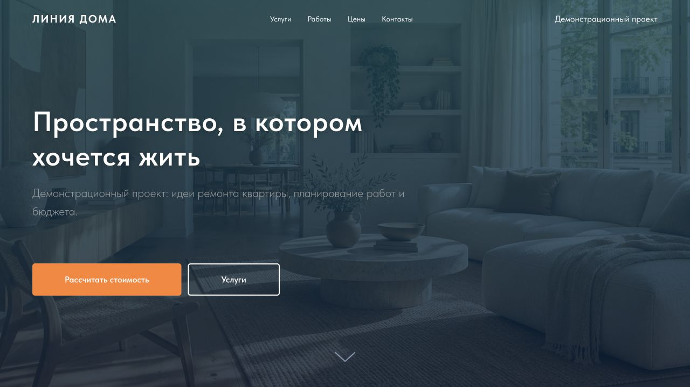

# Автоматизация заявок ремонтной компании

Демонстрационная система помогает принять заявку с сайта, сохранить её до обработки и передать менеджеру в CRM и Telegram. Проект показывает процесс для небольшой ремонтной компании: от формы Tilda до контроля очереди и напоминания о необработанном обращении.

**Статус: локальное демо для вымышленных данных.** Публичная [демонстрационная страница](https://remont.stakko.online) доступна отдельно; приём заявок зависит от запущенного локального стенда и временного HTTPS-туннеля. Это не постоянное размещение и не готовая к обработке реальных персональных данных система.

## Что умеет

- Принимает форму Tilda через защищённый ключом HTTPS webhook, проверяет обязательные поля и нормализует российский номер телефона.
- Сохраняет входящее событие в PostgreSQL до успешного ответа; повтор с тем же идентификатором и данными не создаёт новое событие.
- Запускает обработку очереди по расписанию n8n, классифицирует обращение по бюджету и объединяет заявки по демонстрационному правилу.
- Через отдельный обработчик создаёт контакт и сделку в локальной EspoCRM, отправляет уведомление менеджеру и проверяет необходимость напоминания.
- Хранит состояния и попытки интеграций, предоставляет локальную диагностику и агрегированный отчёт. Неоднозначные результаты требуют ручной сверки.

Адаптер Bitrix24 реализован экспериментально и проверен с тестовыми ответами API; реальный портал не подключался. Адаптера amoCRM в этом репозитории пока нет.

## Как устроено

```text
Форма Tilda ── HTTPS + ключ ──▶ Приёмник ──▶ PostgreSQL: входящие события
                                              │
                                    n8n: запуск по расписанию
                                              │
                                   обработка и задания интеграций
                                              │
                          ┌───────────────────┴──────────────────┐
                          ▼                                      ▼
                   CRM-адаптер                         Telegram Bot API
                   EspoCRM / demo                  уведомление и напоминание
```

n8n запускает обработку очереди, но валидация, логика базы и отправка интеграций находятся также в Python-сервисах и функциях PostgreSQL. Подробнее — [архитектура](docs/architecture.md) и [workflow](workflows/README.md).

## Посмотреть демо



[Форма заявки](assets/screenshots/tilda-form.jpg) · [очередь n8n](assets/screenshots/n8n-workflow.jpg) · [тестовые сделки в EspoCRM](assets/screenshots/espocrm-opportunities.jpg)

Снимок n8n сделан в отдельной копии с импортированным workflow без учётных данных и заявок: предупреждения на узлах означают отсутствие подключения к БД в этой копии. Суммы и сделки на снимке CRM вымышлены и не являются коммерческими результатами.

## Быстрый запуск базовой части

Нужны Docker с Compose и свободный локальный порт `18080`. Команды ниже запускают **PostgreSQL, миграции, приёмник и обработчик с тестовым CRM-провайдером**. Они не запускают n8n, EspoCRM, Tilda, HTTPS-туннель или Telegram, поэтому сами по себе не демонстрируют сквозную обработку.

1. В отдельном клоне репозитория создайте `.env` из примера:

   ```sh
   git clone https://github.com/shelexm/remont-sales-automation.git
   cd remont-sales-automation
   cp .env.example .env
   ```

2. В `.env` замените `POSTGRES_PASSWORD` и `WEBHOOK_KEY` на разные случайные буквенно-цифровые значения длиной не менее 32 символов. Не добавляйте `.env` в Git и не передавайте секреты в чат. Оставьте `CRM_PROVIDER=demo` и `TELEGRAM_ENABLED=false`.

3. Убедитесь, что имя Compose-проекта `remont-example` и порт `127.0.0.1:18080` не используются другим сервисом. Для новой отдельной базы запустите:

   ```sh
   docker compose -p remont-example up -d --build
   docker compose -p remont-example ps
   curl http://127.0.0.1:18080/health
   ```

   Ожидаемый ответ последней команды — `{"status": "ok"}`. Он подтверждает только ответ процесса приёмника, а не доступность CRM, n8n или доставку заявки. Миграции новой базы применяются контейнером `migrate`. Для старого тома до обновления прочитайте [инструкцию миграций](docs/migrations.md).

4. Для остановки без удаления томов используйте `docker compose -p remont-example stop`. Команды `down --volumes` удаляют данные и здесь не нужны.

Чтобы получить работающую связку с отдельными n8n и EspoCRM, следуйте [руководству полного локального демо](infra/local-demo/README.md). При запуске рядом с действующим стендом сначала проверьте имена проектов, тома и порты. База фиксирует выбранный CRM-провайдер; не переключайте существующую базу на другую CRM без отдельной процедуры.

## Что проверено

- В локальном демонстрационном стенде вымышленная заявка прошла через опубликованную форму Tilda, HTTPS-туннель, приёмник и n8n в EspoCRM. Контакт и сделка проверены через CRM API.
- В сквозном тесте получены уведомление о заявке и отдельное напоминание Telegram; получение подтверждено владельцем. Несколько ранних отправок имеют статус `uncertain` после сетевых сбоев: повторять их без ручной сверки нельзя.
- Проведена изолированная тренировка восстановления копий PostgreSQL, n8n и EspoCRM с синтетической заявкой. Копии сняты в разное время; согласованность всей истории, реальная Tilda и Telegram при восстановлении не проверены.
- CI запускает линтер, автоматические тесты, проверки конфигураций и зависимостей, smoke-тест n8n с отдельной PostgreSQL и отдельные проверки резервного копирования. Внешние интеграции в тестах подменяются; CI не заменяет проверку настоящих аккаунтов.

Подробности — [интеграции и ручная сверка](docs/integrations.md), [резервирование и восстановление](infra/backup/README.md).

## Документация

| Что нужно | Документ |
| --- | --- |
| Состав системы и жизненный цикл заявки | [Архитектура](docs/architecture.md) |
| Приём webhook, поля и ответы | [Приём заявок](docs/lead-intake.md) |
| Настройка CRM, Telegram и статусы ошибок | [Интеграции](docs/integrations.md), [Bitrix24](docs/bitrix24.md) |
| Отдельные n8n и EspoCRM | [Локальный демостенд](infra/local-demo/README.md) |
| Форма и подключение Tilda | [Сборка Tilda](docs/tilda/assembly.md) |
| Ежедневные проверки и неисправности | [Памятка оператора](docs/operations.md), [очереди](docs/queue-diagnostics.md), [аналитика](docs/analytics.md) |
| Схема БД и резервные копии | [Миграции](docs/migrations.md), [бэкапы и восстановление](infra/backup/README.md) |
| Экспорт и зависимости n8n | [Workflow](workflows/README.md) |

## Разработка и тесты

Исходный код сервисов находится в `app/`, миграции — в `migrations/`, тесты — в `tests/`, Docker-конфигурация и вспомогательные сценарии — в `infra/`. Требуется Python 3.12 или новее. Для отдельного окружения разработчика:

```sh
python3 -m venv .venv
. .venv/bin/activate
python -m pip install .
python -m unittest discover -s tests -v
```

Без `TEST_DATABASE_URL` тесты, которым нужна PostgreSQL, пропускаются. Если задаёте эту переменную, используйте **только отдельную одноразовую тестовую базу**: тесты очищают её таблицы. Не указывайте базу рабочего демо. Полный набор команд и изоляция CI описаны в [конфигурации GitHub Actions](.github/workflows/ci.yml).

## Ограничения и безопасность

Данные заявок хранятся в БД без шифрования на уровне приложения. Для работы с реальными клиентами нужны оформленные процессы обработки данных, контроль доступа, стабильное защищённое размещение, регулярные зашифрованные копии вне устройства и проверенное восстановление. Локальные бэкапы и отдельный ключ n8n по умолчанию не зашифрованы. Сроки хранения, удаление данных, внешние оповещения и полноценный production-деплой требуют отдельной проработки. Не публикуйте токены, webhook-адреса с секретами, личные контакты и содержимое тестовых заявок.

Проект доступен бесплатно для личного некоммерческого использования по [лицензии](LICENSE). Для коммерческого использования и распространения требуется отдельное разрешение правообладателя. Условия сторонних компонентов действуют отдельно.
