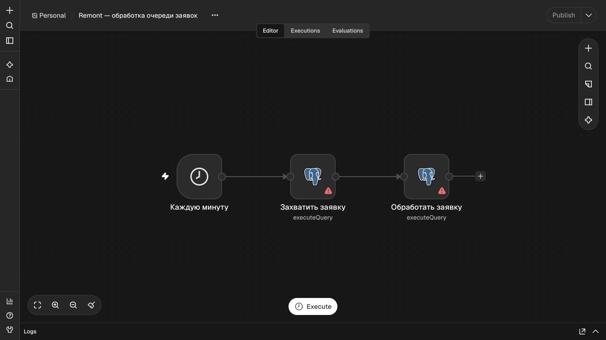

# Workflow обработки заявок n8n

[`process-leads.json`](process-leads.json) — переносимый экспорт workflow. В исходном файле он неактивен и не содержит credentials. Workflow не принимает webhook напрямую: приёмник уже сохранил событие в PostgreSQL.

| Узел | Действие |
| --- | --- |
| «Каждую минуту» | Запускает workflow по расписанию раз в минуту после публикации/активации. |
| «Захватить заявку» | Вызывает `claim_lead` и получает идентификатор доступного события и токен аренды. За один запуск захватывается не более одного события. |
| «Обработать заявку» | Передаёт идентификатор и токен в `process_lead`; создаёт или обновляет внутреннюю карточку и связанные задания. |

Вход — ожидающее или доступное после истечения аренды событие в PostgreSQL. Выход функции обработки — сведения о внутренней карточке и результате дедупликации. Доставка в CRM и Telegram выполняется отдельным обработчиком заданий. Само завершение workflow не подтверждает доставку уведомления или создание сделки.

Для самостоятельного запуска импортируйте файл в отдельный n8n, подключите обе PostgreSQL-ноды к нужной базе и настройте права и сеть. В локальном демостенде подготовка credentials и публикация выполняются bootstrap-скриптом; порядок и ограничения описаны в [локальном руководстве](../infra/local-demo/README.md). Экспорт не содержит реальных паролей. Перед настройкой в рабочем окружении проверьте права БД и исключите попадание содержимого заявок в историю запусков.

В CI импорт и выполнение workflow проверяются с одноразовой PostgreSQL и n8n 2.46.6; расписание там заменено ручным запуском. Отдельно реальная форма с вымышленной заявкой была проверена с локальным работающим n8n по расписанию. Оба вида проверки имеют разные границы: CI не подтверждает доступность текущего туннеля и внешних аккаунтов.

Скриншот сделан в отдельном экземпляре с импортированным workflow, без подключения к БД и заявок. Поэтому n8n показывает предупреждения на PostgreSQL-узлах, а workflow в этой копии не запущен.
